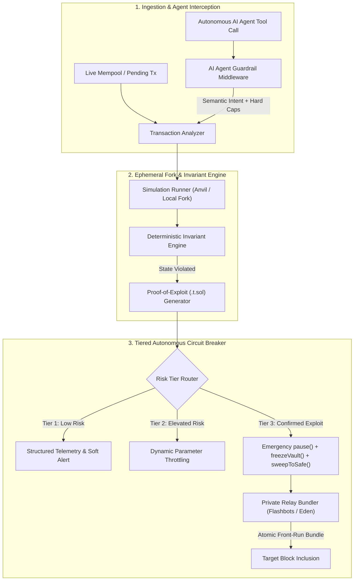

<div align="center">

# 🛡️ GuardianX v2.1

### **Autonomous Web3 Circuit Breaker, Proof-of-Exploit (PoE) Fork Simulator & AI Agent Runtime Firewall**

[](https://www.typescriptlang.org/)
[](https://opensource.org/licenses/MIT)
[](https://docs.flashbots.net/)
[](https://book.getfoundry.sh/)

*Stop getting paged after your vault is already drained. Simulate in local forks, prove exploits deterministically, intercept rogue AI agent tool calls, and front-run attackers via private MEV relays.*

</div>

```typescript
import { createGuardianWallet } from '@guardianx/sdk';
import { createWalletClient, http } from 'viem';
import { mainnet } from 'viem/chains';

const baseClient = createWalletClient({ chain: mainnet, transport: http() });

// Wrap any agent wallet in one line
const guardianWallet = createGuardianWallet({
  client: baseClient,
  policy: {
    maxSlippageBps: 100,
    maxDailySpendWei: parseEther('1.0'),
    allowedContracts: ['0xUniswapRouter...'],
  },
});

// Automatically simulated & validated before signing
await guardianWallet.sendTransaction({ to: '0x...', value: parseEther('0.1') });
```

---

## ⚡ Why GuardianX?

Legacy Web3 monitoring platforms (**OpenZeppelin Defender**, **Forta**, **Tenderly Alerts**) are fundamentally **passive**—they send Discord, PagerDuty, or Telegram webhooks *after* a suspicious transaction is spotted or mined, often resulting in severe **false-positive alert fatigue** or **public mempool front-running** when responders attempt manual `pause()` transactions.

**GuardianX v2.0** is an active, deterministic defense engine engineered for DeFi protocols and autonomous AI agent treasuries:

1. **Zero Alert Fatigue via Proof-of-Exploit (PoE)**: When an anomaly is detected, GuardianX forks the live chain state at the current block, executes the candidate payload, verifies whether state invariants break, and auto-generates a reproducible **Foundry (`.t.sol`)** exploit test before escalating.
2. **MEV-Resistant Autonomous Circuit Breaker**: Instead of leaking emergency `pause()` transactions to the public mempool (where attackers can back-run or front-run them), GuardianX bundles `pause()`, `freezeVault()`, and `sweepToSafe()` directly through **Flashbots / Eden / MEV-Blocker private relays**.
3. **AI Agent Runtime Guardrail Middleware**: An inline execution firewall that intercepts tool calls and unsigned transactions from LLM agents, performing **Semantic Intent Verification** (preventing prompt injection & rogue selector hijacks) alongside **Deterministic Hard Caps** (slippage, gas burn, transfer value, and contract whitelists).

---

## 🏗️ System Architecture



### Modular Codebase Layout

```text
guardianx/
├── guardianx.config.ts              # Declarative TypeScript configuration & invariant hooks
├── src/
│   ├── index.ts                     # Clean ESM/TypeScript SDK exports
│   ├── types/
│   │   └── index.ts                 # Strict domain interfaces & configuration types
│   ├── core/
│   │   ├── invariantEngine.ts       # Deterministic state invariant evaluator & built-in rules
│   │   ├── simulationRunner.ts      # Local fork execution & Foundry (.t.sol) PoE generator
│   │   ├── circuitBreaker.ts        # Tier 1 / Tier 2 / Tier 3 Active Mitigation Engine
│   │   ├── transactionAnalyzer.ts   # End-to-end orchestration pipeline
│   │   └── config.ts                # defineGuardianXConfig() helper & defaults
│   ├── agents/
│   │   └── guardrailMiddleware.ts   # AI Agent Semantic Intent + Deterministic Hard Caps firewall
│   ├── relays/
│   │   └── privateRelay.ts          # Flashbots / Eden / MEV-Blocker atomic rescue bundler
│   ├── cli/
│   │   └── index.ts                 # CLI suite: `guardianx init`, `simulate`, `listen`
│   └── pages/                       # Interactive React 18 + Tailwind Security Dashboard
└── tests/
    └── guardianx.test.ts            # End-to-end unit & integration test suite
```

---

## 📊 Competitive Comparison

| Capability | GuardianX v2.0 | OpenZeppelin Defender | Forta Network | Standard Wallet Simulators |
| :--- | :---: | :---: | :---: | :---: |
| **Detection Mechanism** | **Stateful Fork Invariants + PoE** | Event / Signature Matching | Heuristic Detection Bots | Pre-sign Balance Preview |
| **False-Positive Elimination** | **Auto-generates Foundry `.t.sol` Proof** | ❌ Manual Triage Required | ❌ High Alert Fatigue | ❌ None |
| **Active Exploit Mitigation** | **Tier-3 Auto `pause()` & `sweepToSafe()`** | Webhook / Relayer Script | Passive Alerting Only | ❌ None |
| **Private Mempool Front-Running** | **Native Flashbots / Eden Bundles** | ⚠️ Public Mempool Default | ❌ None | ❌ None |
| **AI Agent Runtime Firewall** | **Semantic Intent + Hard Caps** | ❌ None | ❌ None | ❌ None |
| **Declarative TypeScript Config** | **`guardianx.config.ts` (Typed)** | JSON / Web UI | Docker / Bot Manifests | SaaS API Only |

---

## 🚀 Quickstart (Under 3 Minutes)

### 1. Install & Build

```bash
git clone https://github.com/your-org/guardianx.git
cd guardianx
npm install
npm run build
```

### 2. Initialize Declarative Config (`guardianx init`)

Scaffold a strongly-typed `guardianx.config.ts` in your project:

```bash
npm run guardianx -- init
```

### 3. Run Local Fork Simulation & Generate Proof-of-Exploit (`guardianx simulate`)

Test your vault invariants against a candidate exploit payload and inspect the auto-generated Foundry `.t.sol` harness and Flashbots rescue bundle:

```bash
npm run guardianx -- simulate --target 0x1111111111111111111111111111111111111111
```

### 4. Start the Mempool & Invariant Listener (`guardianx listen`)

```bash
npm run guardianx -- listen
```

### 5. Launch the Interactive Security Dashboard (Optional)

```bash
npm run dev
# Open http://localhost:5173
```

---

## 🛠️ Declarative Configuration (`guardianx.config.ts`)

Define monitored contracts, deterministic state invariants, AI agent hard caps, and emergency circuit-breaker callbacks with full TypeScript autocompletion:

```typescript
import { defineGuardianXConfig, BuiltInInvariants } from './src/index';

export default defineGuardianXConfig({
  projectName: 'Omnichain-Core-Vault',
  network: {
    chain: 'ethereum',
    rpcUrl: process.env.ETH_RPC_URL ?? 'https://eth-mainnet.g.alchemy.com/v2/demo',
    chainId: 1,
    privateRelayUrl: 'https://relay.flashbots.net',
    relayProvider: 'flashbots',
  },
  contracts: [
    {
      name: 'OmnichainLiquidityVault',
      address: '0x1111111111111111111111111111111111111111',
      chain: 'ethereum',
      safeTreasuryAddress: '0x9999999999999999999999999999999999999999',
    },
  ],
  invariants: [
    // Trigger Tier-3 Circuit Breaker if >15% of vault balance is drained in a single block
    BuiltInInvariants.maxBalanceDrainPercentage(
      '0x1111111111111111111111111111111111111111',
      15,
      'critical'
    ),
    // Protect EIP-1967 Proxy Implementation Slot against unauthorized mutation
    BuiltInInvariants.immutableStorageSlot(
      '0x1111111111111111111111111111111111111111',
      '0x360894a13ba1a3210667c828492db98dca3e2076cc3735a920a3ca505d382bbc',
      ['0x9999999999999999999999999999999999999999']
    ),
  ],
  agentGuardrails: {
    maxSlippageBps: 100, // 1.00% hard cap
    maxGasBurnWei: 50000000000000000n, // 0.05 ETH ceiling
    maxTransferValueWei: 10000000000000000000n, // 10 ETH per-tx limit
    allowedContractWhitelist: [
      '0x1111111111111111111111111111111111111111',
      '0x7a250d5630b4cf539739df2c5dacb4c659f2488d',
    ],
  },
  circuitBreaker: {
    enabled: true,
    autoPauseOnTier3: true,
    autoSweepOnTier3: true,
    safeVaultAddress: '0x9999999999999999999999999999999999999999',
    maxPriorityFeeGwei: 80,
  },
});
```

---

## 🤖 AI Agent Runtime Guardrail Example

Protect autonomous on-chain agents against prompt injections and hallucinated parameters before signing:

```typescript
import { AgentGuardrailMiddleware } from './src/index';

const firewall = new AgentGuardrailMiddleware({
  maxSlippageBps: 100,
  maxGasBurnWei: 50000000000000000n,
  maxTransferValueWei: 10000000000000000000n,
  allowedContractWhitelist: ['0x7a250d5630b4cf539739df2c5dacb4c659f2488d'],
});

const decision = firewall.verifyAgentToolCall({
  agentId: 'treasury-rebalancer-01',
  naturalLanguageObjective: 'Swap 1 ETH for USDC on Uniswap with 0.5% slippage',
  toolName: 'uniswapSwap',
  estimatedSlippageBps: 50,
  tx: {
    chain: 'ethereum',
    from: '0xAgentAddress',
    to: '0x7a250d5630b4cf539739df2c5dacb4c659f2488d',
    value: 1000000000000000000n,
    data: '0x7ff36ab500000000000000000000000000000000000000000000000000000000',
  },
});

if (!decision.allowed) {
  throw new Error(`Blocked by GuardianX Agent Firewall: ${decision.semanticVerification.reason}`);
}
```

---

## 🧪 Verification & Testing

Run the full build, strict typecheck, linter, and automated test suite:

```bash
npm run lint        # ESLint strict verification
npm run typecheck   # TypeScript strict verification (App + SDK)
npm test            # Node test runner covering all 5 architectural phases
npm run build       # Compiles SDK (dist/sdk) and Frontend UI (dist/)
```

---

## 🤝 Contributing

We welcome contributions from security researchers, MEV engineers, and AI safety builders:
1. Fork the repository and create a feature branch (`git checkout -b feat/custom-invariant`).
2. Add comprehensive unit tests in `tests/guardianx.test.ts`.
3. Ensure `npm run lint`, `npm run typecheck`, `npm test`, and `npm run build` pass with zero warnings.
4. Open a Pull Request detailing the threat model or invariant addressed.

---

## 📄 License

Released under the **MIT License**.
