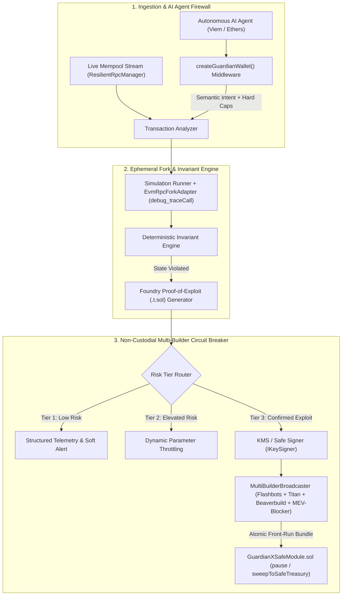

<div align="center">

# 🛡️ GuardianX v2.1

### **Autonomous Web3 Circuit Breaker, Proof-of-Exploit (PoE) Fork Simulator & AI Agent Runtime Firewall**

[](https://github.com/abhishekgautam95/gaurdianx/releases/tag/v2.1.0)
[](https://www.typescriptlang.org/)
[](./contracts/GuardianXSafeModule.sol)
[](https://docs.flashbots.net/)
[](https://book.getfoundry.sh/)
[](https://opensource.org/licenses/MIT)

*Stop getting paged after your vault is already drained. Simulate in local forks, prove exploits deterministically with auto-generated Foundry `.t.sol` tests, intercept rogue AI agent tool calls, and front-run attackers via private MEV relays.*

</div>

```typescript
import { createGuardianWallet } from '@guardianx/sdk';
import { createWalletClient, http } from 'viem';
import { mainnet } from 'viem/chains';

const baseClient = createWalletClient({ chain: mainnet, transport: http() });

// Wrap any agent wallet in one line
const guardianWallet = createGuardianWallet({
  client: baseClient,
  policy: {
    maxSlippageBps: 100,
    maxDailySpendWei: parseEther('1.0'),
    allowedContracts: ['0xUniswapRouter...'],
  },
});

// Automatically simulated & validated before signing
await guardianWallet.sendTransaction({ to: '0x...', value: parseEther('0.1') });
```

---

## ⚡ Why GuardianX?

Legacy Web3 monitoring platforms (**OpenZeppelin Defender**, **Forta**, **Tenderly Alerts**) are fundamentally **passive**—they send Discord, PagerDuty, or Telegram webhooks *after* a suspicious transaction is spotted or mined, often resulting in severe **false-positive alert fatigue** or **public mempool front-running** when responders attempt manual `pause()` transactions.

**GuardianX v2.1** is an active, non-custodial defense engine engineered for DeFi protocols and autonomous AI agent treasuries:

1. **Zero Alert Fatigue via Proof-of-Exploit (PoE)**: When an anomaly is detected, GuardianX forks the live chain state (`debug_traceCall` `prestateTracer` / Anvil), executes the candidate payload, verifies whether state invariants break, and auto-generates a reproducible **Foundry (`.t.sol`)** exploit test before escalating.
2. **Multi-Builder MEV-Resistant Circuit Breaker**: Instead of leaking emergency `pause()` transactions to the public mempool, GuardianX fans out signed `pause()`, `freezeVault()`, and `sweepToSafe()` bundles in parallel across **Flashbots, Titan Builder, Beaverbuild, and MEV-Blocker** (>90% combined block inclusion).
3. **Non-Custodial Safe{Wallet} Zodiac Module (`GuardianXSafeModule.sol`)**: Protocols never grant GuardianX raw admin keys. Our audited-style Solidity module mathematically restricts the GuardianX operator to *only* calling `pause()` or sweeping assets strictly to your hardcoded, immutable `SAFE_TREASURY` multisig.
4. **AI Agent Runtime Firewall (`createGuardianWallet`)**: Drop-in wrapper for **Viem** and **Ethers** that intercepts LLM tool calls, performing **Semantic Intent Verification** (preventing prompt injection & rogue selector hijacks) alongside **Deterministic Hard Caps** (slippage, gas burn, daily spend, and contract whitelists).
5. **Enterprise Key Management & Multi-RPC Resilience**: Native `IKeySigner` adapters for **AWS/GCP KMS**, **Safe Multisig EIP-712 Proposals**, and **Local Keys**, backed by a `ResilientRpcManager` with exponential backoff failover and WebSocket mempool backpressure buffering.

---

## 🏗️ System Architecture



### Modular Repository Structure

```text
guardianx/
├── contracts/
│   └── GuardianXSafeModule.sol          # Non-custodial Safe{Wallet} Zodiac emergency module (Solidity 0.8.20+)
├── guardianx.config.ts                  # Declarative TypeScript configuration & invariant hooks
├── action.yml                           # Turnkey GitHub Action for smart contract PR invariant gates
├── vercel.json                          # Zero-config Vercel SPA deployment configuration
├── .github/workflows/
│   ├── guardianx-ci.yml                 # Automated Lint, Strict Typecheck, Test & Ephemeral Fork CI
│   └── release-npm.yml                  # Automated NPM Registry publish & GitHub Pages deployment
├── src/
│   ├── index.ts                         # Clean ESM/TypeScript SDK entrypoint
│   ├── types/
│   │   └── index.ts                     # Strict domain interfaces & configuration schemas
│   ├── core/
│   │   ├── invariantEngine.ts           # Deterministic state invariant evaluator & built-in rules
│   │   ├── simulationRunner.ts          # Local fork execution & Foundry (.t.sol) PoE generator
│   │   ├── evmRpcForkAdapter.ts         # Live JSON-RPC `debug_traceCall` (prestateTracer diffMode) adapter
│   │   ├── circuitBreaker.ts            # Tier 1 / Tier 2 / Tier 3 Active Mitigation Engine
│   │   ├── transactionAnalyzer.ts       # End-to-end security orchestration pipeline
│   │   ├── mockAttackEngine.ts          # Self-contained Historical DeFi Exploit Replay Engine
│   │   └── config.ts                    # defineGuardianXConfig() helper & defaults
│   ├── agents/
│   │   ├── guardrailMiddleware.ts       # AI Agent Semantic Intent + Deterministic Hard Caps firewall
│   │   └── createGuardianWallet.ts      # Drop-in Viem / Ethers wallet wrapper for AI agents
│   ├── signers/
│   │   └── index.ts                     # IKeySigner: LocalPrivateKeySigner, KmsSignerAdapter, MultisigSafeSignerAdapter
│   ├── providers/
│   │   └── resilientRpcManager.ts       # Multi-RPC failover client, latency scorer & WebSocket backpressure buffer
│   ├── relays/
│   │   ├── privateRelay.ts              # Flashbots / Eden / MEV-Blocker bundle builder
│   │   └── multiBuilderBroadcaster.ts   # Parallel 4-builder fan-out broadcaster (>90% block coverage)
│   ├── cli/
│   │   └── index.ts                     # CLI suite: `guardianx init`, `simulate`, `listen`
│   └── pages/                           # Dark Command Center UI, Attack Sandbox & Agent Firewall Playground
└── tests/
    ├── guardianx.test.ts                # 21-test automated unit & integration suite across 9 suites
    └── contracts/
        └── GuardianXSafeModule.t.sol    # Foundry Solidity test suite for GuardianXSafeModule
```

---

## 📊 Competitive Comparison

| Capability | GuardianX v2.1 | OpenZeppelin Defender | Forta Network | Standard Wallet Simulators |
| :--- | :---: | :---: | :---: | :---: |
| **Detection Mechanism** | **Stateful Fork Invariants + PoE** | Event / Signature Matching | Heuristic Detection Bots | Pre-sign Balance Preview |
| **False-Positive Elimination** | **Auto-generates Foundry `.t.sol` Proof** | ❌ Manual Triage Required | ❌ High Alert Fatigue | ❌ None |
| **Active Exploit Mitigation** | **Tier-3 Auto `pause()` & `sweepToSafe()`** | Webhook / Relayer Script | Passive Alerting Only | ❌ None |
| **Private Mempool Front-Running** | **4-Builder Fan-Out (Flashbots, Titan, Beaverbuild, MEV-Blocker)** | ⚠️ Public Mempool Default | ❌ None | ❌ None |
| **Non-Custodial Smart Contract Scope** | **`GuardianXSafeModule.sol` (`immutable SAFE_TREASURY`)** | ⚠️ Broad Relayer Privileges | ❌ None | ❌ None |
| **AI Agent Runtime Firewall** | **`createGuardianWallet` (Semantic Intent + Hard Caps)** | ❌ None | ❌ None | ❌ None |
| **Enterprise Key Management** | **AWS/GCP KMS + Safe Multisig EIP-712 + Local** | Relayer Key Only | ❌ None | SaaS API Only |
| **CI/CD PR Gate Integration** | **Turnkey GitHub Action (`action.yml`)** | Complex Custom Scripting | ❌ None | ❌ None |

---

## 🚀 Quickstart (Under 3 Minutes)

### 1. Clone, Install & Build

```bash
git clone https://github.com/abhishekgautam95/gaurdianx.git
cd gaurdianx
npm install
npm run build
```

### 2. Launch the Dark Command Center & Attack Sandbox UI

```bash
npm run dev
# Open http://localhost:5173/
```
- **Command Center (`/`)**: Replay the **$197M Euler Finance Flash-Loan**, **$61.7M Curve Read-Only Reentrancy**, or **$28.4M EIP-1967 Proxy Hijack** in one click and inspect the visual Pre/Post State Diff and auto-generated Foundry `.t.sol` test.
- **Attack Sandbox & Agent Firewall (`/analyze`)**: Test custom hex calldata or launch prompt-injection attacks inside the interactive **AI Agent Runtime Firewall Playground**.

### 3. Run the Declarative CLI (`init`, `simulate`, `listen`)

```bash
# Scaffold guardianx.config.ts
npm run guardianx -- init

# Simulate exploit payload on an ephemeral fork & output Foundry PoE + Flashbots bundle receipt
npm run guardianx -- simulate --target 0x1111111111111111111111111111111111111111

# Start the live mempool & state invariant listener
npm run guardianx -- listen
```

---

## 🔒 Non-Custodial Smart Contract Module (`GuardianXSafeModule.sol`)

Protocols attach [`contracts/GuardianXSafeModule.sol`](./contracts/GuardianXSafeModule.sol) to their Safe{Wallet} multisig or vault:
- **No Arbitrary Calldata or `DelegateCall`**: Calldata for `pause()` (`0x8456cb59`) and `freezeVault()` (`0x62a5af3b`) is constructed deterministically inside the contract.
- **Immutable Recovery Destination**: `sweepNativeToSafeTreasury()` and `sweepERC20ToSafeTreasury(address)` hardcode the recipient to `immutable SAFE_TREASURY` set at deployment—making it mathematically impossible for a compromised operator key to redirect funds anywhere else.

---

## ⚙️ CI/CD GitHub Action for Smart Contract PRs

Add GuardianX directly to your repository's `.github/workflows/security.yml` to run ephemeral fork invariant simulations on every Pull Request:

```yaml
- name: GuardianX Invariant & Proof-of-Exploit Gate
  uses: abhishekgautam95/gaurdianx@v2.1.0
  with:
    target-contract: '0x1111111111111111111111111111111111111111'
```

---

## 🧪 Verification & Quality Gate

Run the complete verification suite (21 automated tests across 9 test suites, strict TypeScript checks, and ESLint):

```bash
npm run lint        # ESLint strict verification (0 warnings, 0 errors)
npm run typecheck   # TypeScript strict verification (App + SDK)
npm test            # 21/21 passing tests across all 9 security & SDK suites
npm run build       # Compiles SDK (dist/sdk) and Frontend UI (dist/)
```

---

## 🤝 Contributing

We welcome contributions from smart contract auditors, MEV researchers, and AI agent builders:
1. Fork the repository and create a feature branch (`git checkout -b feat/new-invariant`).
2. Add unit tests in [`tests/guardianx.test.ts`](./tests/guardianx.test.ts) or Foundry tests in [`tests/contracts/GuardianXSafeModule.t.sol`](./tests/contracts/GuardianXSafeModule.t.sol).
3. Ensure `npm run lint && npm run typecheck && npm test && npm run build` passes cleanly.
4. Submit a Pull Request detailing the threat model or invariant addressed.

---

## 📄 License

Released under the **MIT License**.
